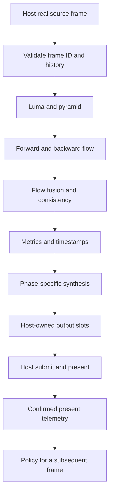

# AromaFG architecture

## Layers

1. **Portable core:** versioned C ABI, configuration, frame IDs, lifecycle, bypass and backend callback contract.
2. **Compute backend:** Vulkan pipelines, intermediate resources, flow estimation and synthesis.
3. **Host adapter:** supplies borrowed resources and command buffer; owns queue submission, swapchain, semaphores and presentation.
4. **Policy/telemetry:** deterministic adaptive recommendations and passive performance/event recording.
5. **Tools:** offline shader compiler, JSONL analyzer, benchmarks and validation harness.

## Frame flow

Flow is computed once for a consecutive source pair. Multiplier M can produce at most M-1 distinct chronological phases. It must not repeat a midpoint to claim ×3/×4.

## Ownership

Host owns Vulkan instance/device/queue, command buffers, swapchain, WSI semaphores, submission and presentation. AromaFG owns only its private pipelines, descriptors, samplers, intermediate images and allocations. Borrowed handles are valid only for the documented callback lifetime.

## Failure model

Invalid frame order, scene discontinuity, unsupported formats/capabilities, device loss or backend failure must preserve source-frame fallback. No synchronous GPU wait or full-frame CPU readback in the render path.

## Policy boundary

The adaptive controller consumes validated scalar metrics and recommends bounded workload changes for later frames. It never controls barriers, queue ownership, semaphore waits, swapchain acquisition or present scheduling.